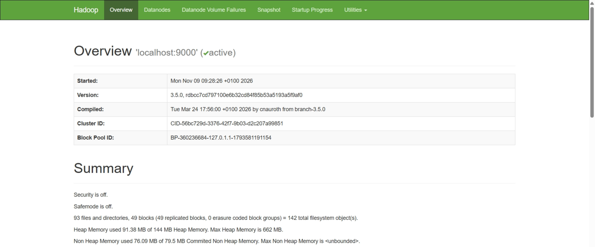
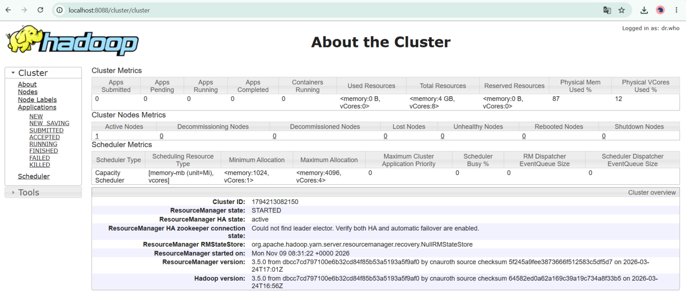
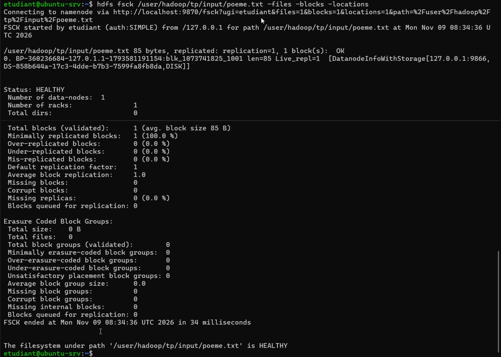
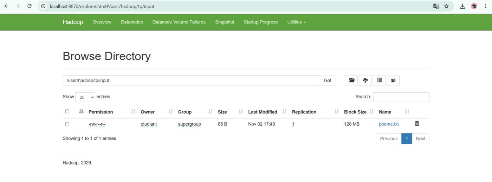
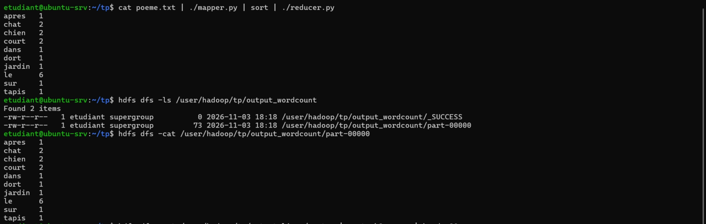
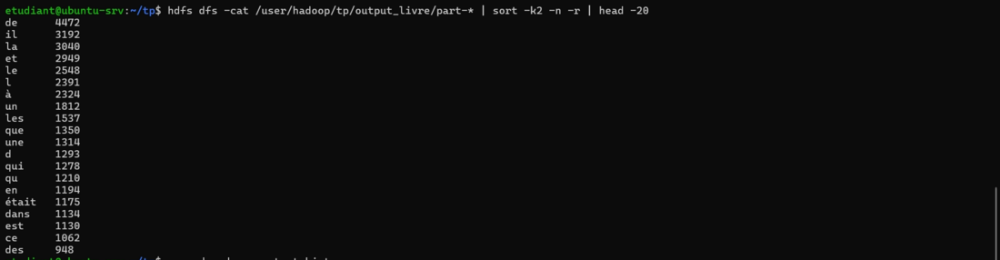
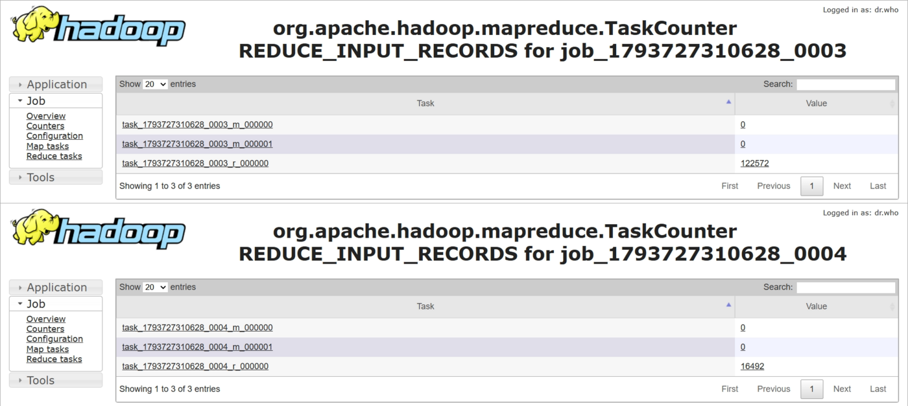
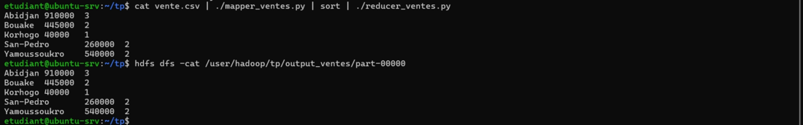
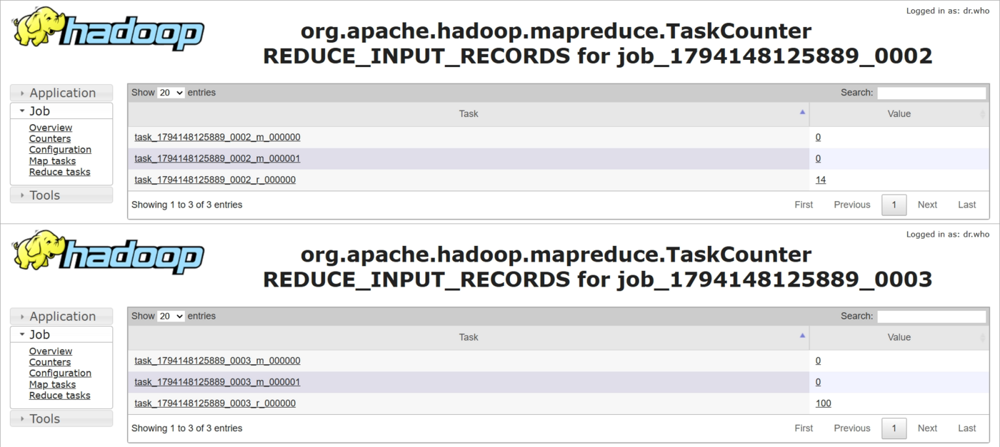

# Compte rendu TP — Clusters, Hadoop et MapReduce en Python

**Cours :** Introduction au Big Data · L3 SI BDGL  
**Étudiant :** TRAORE IBRAHIM  
**Professeur :** Dr. Bakayoko

---

## Environnement

| Élément | Utilisé |
| --- | --- |
| Système | Ubuntu Server 26.04.1 LTS (VM VirtualBox, réseau NAT, disque de 11,21 Go) |
| Hadoop | **3.5.0** (dernière version stable, avril 2026) |
| Java | **OpenJDK 17** (exigé par Hadoop 3.5.0) |
| Utilisateur | `etudiant` (chemins en `/home/etudiant/...`) |
| Mode | Pseudo-distribué : 1 NameNode, 1 DataNode ; scripts Python via Hadoop Streaming |

| Démon | Rôle | Interface web |
| --- | --- | --- |
| `NameNode` | Maître HDFS : arborescence et emplacement des blocs | `http://localhost:9870` |
| `DataNode` | Stockage des blocs | `http://localhost:9864` |
| `SecondaryNameNode` | Checkpoint de `fsimage` et `edits` | — |
| `ResourceManager` | Maître YARN : arbitre les ressources | `http://localhost:8088` |
| `NodeManager` | Exécute les conteneurs | — |
| `JobHistoryServer` | Compteurs des jobs terminés | `http://localhost:19888` |

La VM étant en réseau NAT, les interfaces web sont consultées depuis Windows par un **tunnel SSH** : `ssh -p 2222 -L 9870:localhost:9870 -L 8088:localhost:8088 -L 19888:localhost:19888 etudiant@127.0.0.1`.

---

## Partie 0 — Installer et démarrer Hadoop

### 0.0 Préparer la VM  et créer le compte `hadoop` 

**Commandes** (VM, compte `etudiant`)

```bash
sudo apt update && sudo apt upgrade -y
sudo apt install -y openjdk-17-jdk ssh pdsh wget python3
java -version
```

**Lecture.** `apt update && apt upgrade -y` met à jour la liste des paquets puis le système ; la seconde commande installe **Java 17** (version exigée par Hadoop 3.5.0), le serveur SSH, `pdsh` (utilisé par les scripts de démarrage de Hadoop), `wget` et Python 3 (`wget` et `python3` étaient déjà à jour). `java -version` vérifie la version de Java installée.

**Commandes** (VM) — création du compte `hadoop` demandé par le sujet

```bash
sudo adduser hadoop
sudo usermod -aG sudo hadoop
su - hadoop
```

**Lecture.** `adduser hadoop` crée l'utilisateur : il demande un mot de passe (saisi deux fois), puis les informations d'identité (nom, téléphone…) laissées par défaut sauf le nom, et la confirmation `Is the information correct? [Y/n]` (réponse `yes`). `usermod -aG sudo hadoop` ajoute le compte au groupe `sudo`. `su - hadoop` ouvre une session complète sous ce compte (invite `hadoop@ubuntu-srv:~$`). 

### 0.1 SSH sans mot de passe

**Commandes** (VM)

```bash
ssh-keygen -t rsa -P '' -f ~/.ssh/id_rsa
cat ~/.ssh/id_rsa.pub >> ~/.ssh/authorized_keys
chmod 0600 ~/.ssh/authorized_keys
ssh localhost
exit                    # quitte la session ouverte par ssh localhost
```

**Lecture.** `ssh-keygen -P ''` crée une paire de clés sans phrase secrète ; la clé publique est ajoutée à `authorized_keys`. `ssh localhost` se connecte alors **sans mot de passe** : c'est ce dont `start-dfs.sh` a besoin pour lancer les démons.

### 0.2 Télécharger Hadoop 3.5.0

**Commandes** (VM)

```bash
wget https://downloads.apache.org/hadoop/common/hadoop-3.5.0/hadoop-3.5.0.tar.gz
tar -xzf hadoop-3.5.0.tar.gz
mv hadoop-3.5.0 hadoop
```

**Lecture.** L'archive (581 280 703 octets) a été téléchargée en entier. Le dossier est renommé `hadoop` pour avoir un chemin stable (`HADOOP_HOME`).

### 0.3 Java 17 et variables d'environnement

**Commandes** (VM)

```bash
nano ~/.bashrc          # ajouter le bloc ci-dessous à la fin
source ~/.bashrc
hadoop version
```

```bash
# ---- Hadoop ----
export JAVA_HOME=/usr/lib/jvm/java-17-openjdk-amd64   # emplacement de Java
export HADOOP_HOME=$HOME/hadoop                       # racine de l'installation Hadoop
export HADOOP_CONF_DIR=$HADOOP_HOME/etc/hadoop        # dossier des fichiers de configuration
export HADOOP_MAPRED_HOME=$HADOOP_HOME                # composants MapReduce, Common, HDFS et YARN
export HADOOP_COMMON_HOME=$HADOOP_HOME
export HADOOP_HDFS_HOME=$HADOOP_HOME
export HADOOP_YARN_HOME=$HADOOP_HOME
export PDSH_RCMD_TYPE=ssh                             # pdsh passe par SSH pour lancer les démons
export PATH=$PATH:$HADOOP_HOME/bin:$HADOOP_HOME/sbin  # commandes hadoop, hdfs, start-dfs.sh...
```

**Réponse** (`hadoop version`)

```text
Hadoop 3.5.0
Compiled by cnauroth on 2026-03-24T16:56Z
This command was run using /home/etudiant/hadoop/share/hadoop/common/hadoop-common-3.5.0.jar
```

**Lecture.** Hadoop 3.5.0 est compilé pour **Java 17** 

### 0.4 Configuration

**Commandes** (VM)

```bash
cd $HADOOP_HOME/etc/hadoop
echo 'export JAVA_HOME=/usr/lib/jvm/java-17-openjdk-amd64' >> hadoop-env.sh
nano core-site.xml hdfs-site.xml mapred-site.xml yarn-site.xml
sed -i 's#/home/hadoop/#/home/etudiant/#g' core-site.xml hdfs-site.xml mapred-site.xml
grep -h "/home/" $HADOOP_HOME/etc/hadoop/*-site.xml
mkdir -p ~/hadoopdata/{namenode,datanode,tmp}
```

**Lecture.** `core-site.xml` fixe `fs.defaultFS = hdfs://localhost:9000` et `hadoop.tmp.dir`. `hdfs-site.xml` indique les dossiers du NameNode et du DataNode et une réplication de 1 (un seul DataNode). `mapred-site.xml` et `yarn-site.xml` activent YARN pour MapReduce ; `yarn-site.xml` déclare aussi `yarn.application.classpath` (chemins explicites des JAR de Hadoop) pour que les conteneurs YARN trouvent les bibliothèques. Les chemins du sujet (`/home/hadoop/...`) ont été remplacés par `/home/etudiant/...` avec `sed` ; le `grep` ne doit plus afficher que des chemins en `/home/etudiant/...`. `JAVA_HOME` est aussi déclaré dans `hadoop-env.sh`, car les démons lancés par SSH ne lisent pas `~/.bashrc`.

### 0.5 Formater et démarrer le cluster

**Commandes** (VM)

```bash
hdfs namenode -format      # une seule fois : efface l'état de HDFS
start-dfs.sh
start-yarn.sh
mapred --daemon start historyserver
jps
```

**Réponse** (`jps`)

```text
28629 NameNode
28758 DataNode
28951 SecondaryNameNode
29242 ResourceManager
29385 NodeManager
29940 Jps
```

**Lecture.** Les cinq démons attendus sont présents (`Jps` est l'outil lui-même). Après un redémarrage de la VM, on relance `start-dfs.sh` et `start-yarn.sh` **sans reformater**.

### 0.6 Interfaces web

**Commandes** (VM)

```bash
curl -sI http://localhost:9870 | head -1
curl -sI http://localhost:8088 | head -1
curl -sI http://localhost:9864 | head -1
```

**Réponse**

```text
HTTP/1.1 302 Found
HTTP/1.1 302 Found
HTTP/1.1 302 Found
```



*Capture 1 — NameNode :* `localhost:9000 (active)`*, version 3.5.0, Safemode off, capacité configurée de 11,21 Go.*



*Capture 2 — ResourceManager : état* `STARTED`*, 1 nœud actif, 4 Go de mémoire et 8 vCores disponibles.*

**Lecture.** Les trois interfaces (9870, 8088, 9864) répondent par une redirection `HTTP 302`, signe que les services web sont actifs.

---

## Partie 1 — Manipuler HDFS (Exercice 1)

**Commandes** (VM)

```bash
hdfs dfs -mkdir -p /user/hadoop/tp/input
mkdir -p ~/tp && cd ~/tp
cat > poeme.txt << 'EOF'
le chat dort sur le tapis
le chien court dans le jardin
le chat court apres le chien
EOF
hdfs dfs -put poeme.txt /user/hadoop/tp/input/
hdfs dfs -ls /user/hadoop/tp/input
hdfs dfs -cat /user/hadoop/tp/input/poeme.txt
hdfs fsck /user/hadoop/tp/input/poeme.txt -files -blocks -locations
```

**Réponse**

```text
-rw-r--r--   1 etudiant supergroup   85 2026-11-02 16:49 /user/hadoop/tp/input/poeme.txt
```



*Capture 3 —* `fsck` *: 1 bloc de 85 octets, réplication 1,* `Status: HEALTHY`*, 1 DataNode, 0 bloc manquant ou corrompu.*



*Capture 4 — Explorateur du NameNode sur* `/user/hadoop/tp/input` *:* `poeme.txt`*, 85 B, réplication 1, taille de bloc 128 MB.*

**Lecture.** `hdfs dfs` agit sur le système de fichiers **distribué** ; `-put` copie un fichier local vers HDFS. `fsck` détaille les blocs (`-blocks`) et leur emplacement (`-locations`) : l'unique bloc est sur le DataNode local.

### Réponses aux questions

**Q1. Combien de blocs** `poeme.txt` **occupe-t-il ? Pourquoi ?**
**1 seul bloc.** Le fichier (85 octets) est bien plus petit que la taille d'un bloc HDFS (128 Mo) : HDFS ne découpe un fichier que s'il dépasse cette taille. Le bloc n'occupe que 85 octets sur le disque : 128 Mo est une limite, pas un espace réservé.

**Q2. Retrouvez le fichier dans l'interface web.**
Voir la figure 4 : le fichier apparaît dans *Utilities → Browse the file system* en saisissant le chemin `/user/hadoop/tp/input`.

**Q3. Blocs et espace disque d'un fichier de 1 Go avec une réplication de 3 ?**
1 Go = 1 024 Mo, soit 1 024 / 128 = **8 blocs**. Avec une réplication de 3 : 8 × 3 = **24 blocs stockés**, soit **3 Go** d'espace disque.

---

## Partie 2 — MapReduce en Python (Hadoop Streaming)

Avec Hadoop Streaming, le mapper et le reducer sont de simples programmes qui lisent l'entrée standard et écrivent des lignes `clé<TAB>valeur`. Tous les tests locaux utilisent le tube `cat fichier | mapper | sort | reducer`, où `sort` joue le rôle du *shuffle & sort*.

### 2.1 Exercice 2 — WordCount

**Pseudo-code**

```text
map(ligne) :                      reduce(mot, liste_de_1) :
    pour chaque mot de ligne :        émettre(mot, somme(liste_de_1))
        émettre(mot, 1)
```

**Code source** (`~/tp/mapper.py` puis `~/tp/reducer.py`)

```python
#!/usr/bin/env python3
# (ligne 1 : « shebang » — indique au système d'exécuter ce fichier avec Python 3)
"""mapper.py : émet (mot, 1) pour chaque mot lu sur l'entrée standard."""
import sys   # sys : donne accès à l'entrée standard (stdin)
import re    # re : expressions régulières, pour extraire les mots

for ligne in sys.stdin:                  # Hadoop envoie le texte ligne par ligne sur stdin
    ligne = ligne.strip().lower()        # retire espaces et retour à la ligne, passe en minuscules
    # trouve toutes les suites de lettres (accents compris) ; ponctuation et chiffres sont écartés
    mots = re.findall(r"[a-zàâäéèêëîïôöùûüç]+", ligne)
    for mot in mots:                     # pour chaque mot trouvé dans la ligne
        print(f"{mot}\t1")               # émet la paire clé<TAB>valeur : clé = le mot, valeur = 1
```

```python
#!/usr/bin/env python3
# (ligne 1 : « shebang » — indique au système d'exécuter ce fichier avec Python 3)
"""reducer.py : additionne les compteurs de chaque mot.
Les lignes arrivent triées par clé : les occurrences d'un même mot sont consécutives."""
import sys   # sys : donne accès à l'entrée standard (stdin)

mot_courant = None   # mot en cours de traitement (None : aucun mot lu pour l'instant)
total = 0            # somme des valeurs déjà lues pour le mot courant

for ligne in sys.stdin:                                    # lit chaque paire envoyée par le shuffle
    mot, valeur = ligne.rstrip("\n").split("\t", 1)        # sépare « mot<TAB>valeur » en deux champs
    try:
        valeur = int(valeur)                               # convertit le texte « 1 » en entier
    except ValueError:
        continue                                           # valeur invalide : on ignore la ligne

    if mot == mot_courant:                                 # même mot que la ligne précédente :
        total += valeur                                    #   on cumule dans le total
    else:                                                  # nouveau mot :
        if mot_courant is not None:                        #   (sauf à la toute première ligne)
            print(f"{mot_courant}\t{total}")               #   on émet le résultat du mot précédent
        mot_courant = mot                                  #   on passe au nouveau mot
        total = valeur                                     #   et on repart de sa première valeur

if mot_courant is not None:                                # après la boucle, il reste le dernier mot
    print(f"{mot_courant}\t{total}")                       # on émet son résultat
```

**Commandes** (VM)

```bash
cd ~/tp && chmod +x mapper.py reducer.py
cat poeme.txt | ./mapper.py | sort | ./reducer.py          # test local

hadoop jar $HADOOP_HOME/share/hadoop/tools/lib/hadoop-streaming-3.5.0.jar \
  -files mapper.py,reducer.py \
  -mapper "python3 mapper.py" -reducer "python3 reducer.py" \
  -input /user/hadoop/tp/input -output /user/hadoop/tp/output_wordcount
hdfs dfs -ls /user/hadoop/tp/output_wordcount
hdfs dfs -cat /user/hadoop/tp/output_wordcount/part-00000
```

**Réponse**



*Capture 5 — Le test local et le job Hadoop donnent le même résultat. Dossier de sortie :* `_SUCCESS` *(0 octet) et* `part-00000` *(73 octets).*

**Lecture.** Le job lit 3 lignes (`Map input records=3`), produit 18 paires `(mot, 1)` (`Map output records=18`) et 10 mots distincts (`Reduce input groups=10`). Vérification à la main : `le` apparaît 2 fois par ligne sur 3 lignes, soit 6 ; `chat`, `chien` et `court` apparaissent dans deux lignes.

#### Étape 5 — Un vrai texte : *Les Misérables*

**Commandes** (VM)

```bash
wget -O ~/tp/miserables.txt https://www.gutenberg.org/cache/epub/17489/pg17489.txt
hdfs dfs -mkdir -p /user/hadoop/tp/livre
hdfs dfs -put ~/tp/miserables.txt /user/hadoop/tp/livre/
hadoop jar $HADOOP_HOME/share/hadoop/tools/lib/hadoop-streaming-3.5.0.jar -files mapper.py,reducer.py -mapper "python3 mapper.py" -reducer "python3 reducer.py" -input /user/hadoop/tp/livre -output /user/hadoop/tp/output_livre
hdfs dfs -cat /user/hadoop/tp/output_livre/part-* | sort -k2 -n -r | head -20
```



*Capture 6 — Top 20 :* `de` *(4 472),* `il` *(3 192),* `la` *(3 040),* `et` *(2 949),* `le` *(2 548)…*

**Lecture.** Les mots les plus fréquents sont des mots grammaticaux. Les « mots » `l`, `d` et `qu` sont des artefacts du mapper : le motif `[a-zàâä...]+` ne contient pas l'apostrophe, donc `l'homme` est coupé en `l` et `homme`.

#### Comparer avec et sans combiner

Le job a été lancé sans `-combiner` (`job_1793727310628_0003`), puis avec `-combiner "python3 reducer.py"` (`job_1793727310628_0004`). Le compteur `REDUCE_INPUT_RECORDS` est lu dans l'historique des jobs (`http://localhost:19888`).



*Capture 7 — Jobs 0003 (sans combiner) et 0004 (avec combiner).*

| Job | Configuration | Reduce input records |
| --- | --- | --- |
| `…_0003` | sans combiner | **122 572** |
| `…_0004` | avec combiner | **16 492** |

**Lecture.** Réduction de (122 572 − 16 492) / 122 572 ≈ **86,5 %**, soit environ **7,4 fois moins** d'enregistrements pour le reducer. Chaque tâche map additionne d'abord ses doublons : au lieu de milliers de `(de, 1)`, elle envoie un seul `(de, total)`. Le combiner est valable parce que l'addition est **associative et commutative** et que le reducer lit et écrit le même format. Sur le petit poème, la baisse n'était que de 18 à 14 enregistrements : le gain croît avec le volume.

---

### 2.2 Exercice 3 — Chiffre d'affaires par ville

**Pseudo-code**

```text
map(ligne) :                                   reduce(ville, montants) :
    t = analyser(ligne)                            émettre(ville, (somme(montants), taille(montants)))
    émettre(t.ville, t.quantite × t.prix_unitaire)
```

**Données** (`~/tp/vente.csv`, 10 ventes dans 5 villes)

```text
date,ville,produit,quantite,prix_unitaire
2026-01-03,Abidjan,Ordinateur,2,350000
2026-01-03,Bouake,Imprimante,1,95000
2026-01-04,Abidjan,Souris,10,5000
2026-01-05,Yamoussoukro,Ordinateur,1,350000
2026-01-05,San-Pedro,Ecran,3,80000
2026-01-06,Bouake,Ordinateur,1,350000
2026-01-06,Abidjan,Ecran,2,80000
2026-01-07,Korhogo,Clavier,5,8000
2026-01-07,San-Pedro,Souris,4,5000
2026-01-08,Yamoussoukro,Imprimante,2,95000
```

**Code source** (`~/tp/mapper_ventes.py` puis `~/tp/reducer_ventes.py`)

```python
#!/usr/bin/env python3
# (ligne 1 : « shebang » — indique au système d'exécuter ce fichier avec Python 3)
"""mapper_ventes.py : émet (ville, montant) pour chaque vente."""
import sys   # sys : donne accès à l'entrée standard (stdin)

for ligne in sys.stdin:                                  # une ligne du CSV à la fois
    ligne = ligne.strip()                                # retire espaces et retour à la ligne
    if not ligne or ligne.startswith("date"):            # ligne vide ou en-tête du CSV :
        continue                                         #   on l'ignore
    champs = ligne.split(",")                            # découpe la ligne selon les virgules
    if len(champs) != 5:                                 # format attendu : 5 colonnes
        continue                                         #   sinon on ignore la ligne
    _, ville, _, quantite, prix = champs                 # date et produit sont inutiles (« _ »)
    try:
        montant = int(quantite) * float(prix)            # montant de la vente = quantité × prix
    except ValueError:                                   # nombre invalide :
        continue                                         #   on ignore la ligne
    print(f"{ville}\t{montant}")                         # émet (clé = ville, valeur = montant)
```

```python
#!/usr/bin/env python3
# (ligne 1 : « shebang » — indique au système d'exécuter ce fichier avec Python 3)
"""reducer_ventes.py : chiffre d'affaires total et nombre de ventes par ville."""
import sys   # sys : donne accès à l'entrée standard (stdin)

ville_courante, total, nb = None, 0.0, 0   # ville en cours, son CA cumulé, son nombre de ventes

def emettre(ville, total, nb):             # fonction qui affiche le résultat d'une ville
    print(f"{ville}\t{total:.0f}\t{nb}")   # ville, CA sans décimales, nombre de ventes

for ligne in sys.stdin:                                  # lignes triées par ville
    ville, montant = ligne.rstrip("\n").split("\t")      # sépare « ville<TAB>montant »
    montant = float(montant)                             # convertit le montant en nombre
    if ville == ville_courante:                          # même ville que la ligne précédente :
        total += montant                                 #   on ajoute le montant au CA
        nb += 1                                          #   on compte une vente de plus
    else:                                                # nouvelle ville :
        if ville_courante is not None:                   #   (sauf à la première ligne)
            emettre(ville_courante, total, nb)           #   on émet la ville précédente
        ville_courante, total, nb = ville, montant, 1    #   on repart avec la nouvelle ville

if ville_courante is not None:                           # après la boucle, il reste la dernière ville
    emettre(ville_courante, total, nb)                   # on l'émet
```

**Commandes** (VM)

```bash
cd ~/tp && chmod +x mapper_ventes.py reducer_ventes.py
cat vente.csv | ./mapper_ventes.py | sort | ./reducer_ventes.py      # test local

hdfs dfs -mkdir -p /user/hadoop/tp/ventes
hdfs dfs -put vente.csv /user/hadoop/tp/ventes/
hadoop jar $HADOOP_HOME/share/hadoop/tools/lib/hadoop-streaming-3.5.0.jar -files mapper_ventes.py,reducer_ventes.py -mapper "python3 mapper_ventes.py" -reducer "python3 reducer_ventes.py" -input /user/hadoop/tp/ventes -output /user/hadoop/tp/output_ventes
hdfs dfs -ls /user/hadoop/tp/output_ventes
hdfs dfs -cat /user/hadoop/tp/output_ventes/part-00000
```

**Réponse**



*Capture 8 — Le test local et le résultat du cluster sont identiques.*

| Ville | Calcul | CA total | Ventes |
| --- | --- | --- | --- |
| Abidjan | 2×350 000 + 10×5 000 + 2×80 000 | **910 000** | 3 |
| Bouake | 1×95 000 + 1×350 000 | **445 000** | 2 |
| Korhogo | 5×8 000 | **40 000** | 1 |
| San-Pedro | 3×80 000 + 4×5 000 | **260 000** | 2 |
| Yamoussoukro | 1×350 000 + 2×95 000 | **540 000** | 2 |

**Lecture.** Chaque valeur se vérifie à la main ; le total général est de 2 195 000 sur 10 ventes. Ce reducer **ne peut pas servir de combiner** : il reçoit deux colonnes (`ville`, `montant`) mais en émet trois (`ville`, `total`, `nb`), alors qu'un combiner doit lire et écrire le même format.

---

### 2.3 Exercice 4 — Température maximale par année

**Pseudo-code** (modèle « maximum par clé », cours diapositive 16)

```text
map(ligne) :                         reduce(annee, temperatures) :
    t = analyser(ligne)                  émettre(annee, max(temperatures))
    émettre(t.annee, t.temperature)
```

**Données** (`~/tp/meteo.txt`, format `annee,station,temperature`)

```text
2024,ABJ,31.2
2024,BKE,33.5
2025,ABJ,32.8
2025,KHG,36.1
2024,KHG,35.0
2025,BKE,30.9
```

**Code source** (`~/tp/mapper_meteo.py` puis `~/tp/reducer_meteo.py`)

```python
#!/usr/bin/env python3
# (ligne 1 : « shebang » — indique au système d'exécuter ce fichier avec Python 3)
"""mapper_meteo.py : émet (année, température) pour chaque mesure."""
import sys   # sys : donne accès à l'entrée standard (stdin)

for ligne in sys.stdin:                  # une mesure par ligne : annee,station,temperature
    ligne = ligne.strip()                # retire espaces et retour à la ligne
    if not ligne:                        # ligne vide :
        continue                         #   on l'ignore
    champs = ligne.split(",")            # découpe la ligne selon les virgules
    if len(champs) != 3:                 # format attendu : 3 colonnes
        continue                         #   sinon on ignore la ligne
    annee, _, temp = champs              # la station (« _ ») n'est pas utilisée
    try:
        temp = float(temp)               # convertit la température en nombre
    except ValueError:                   # valeur invalide (ou en-tête) :
        continue                         #   on ignore la ligne
    print(f"{annee}\t{temp}")            # émet (clé = année, valeur = température)
```

```python
#!/usr/bin/env python3
# (ligne 1 : « shebang » — indique au système d'exécuter ce fichier avec Python 3)
"""reducer_meteo.py : température maximale par année (entrées triées par année)."""
import sys   # sys : donne accès à l'entrée standard (stdin)

annee_courante, maximum = None, None     # année en cours et plus grande température vue

for ligne in sys.stdin:                                  # lignes triées par année
    annee, temp = ligne.rstrip("\n").split("\t")         # sépare « année<TAB>température »
    temp = float(temp)                                   # convertit la température en nombre
    if annee == annee_courante:                          # même année que la ligne précédente :
        if temp > maximum:                               #   si cette température est plus grande,
            maximum = temp                               #   elle devient le nouveau maximum
    else:                                                # nouvelle année :
        if annee_courante is not None:                   #   (sauf à la première ligne)
            print(f"{annee_courante}\t{maximum}")        #   on émet le maximum de l'année précédente
        annee_courante, maximum = annee, temp            #   on repart avec la nouvelle année

if annee_courante is not None:                           # après la boucle, il reste la dernière année
    print(f"{annee_courante}\t{maximum}")                # on émet son maximum
```

**Commandes** (VM)

```bash
cd ~/tp && chmod +x mapper_meteo.py reducer_meteo.py
cat meteo.txt | ./mapper_meteo.py                                    # test local : sortie du mapper
cat meteo.txt | ./mapper_meteo.py | sort                             # après le tri
cat meteo.txt | ./mapper_meteo.py | sort | ./reducer_meteo.py        # résultat final

hdfs dfs -mkdir -p /user/hadoop/tp/meteo
hdfs dfs -put -f meteo.txt /user/hadoop/tp/meteo/
hadoop jar $HADOOP_HOME/share/hadoop/tools/lib/hadoop-streaming-3.5.0.jar -files mapper_meteo.py,reducer_meteo.py -mapper "python3 mapper_meteo.py" -combiner "python3 reducer_meteo.py" -reducer "python3 reducer_meteo.py" -input /user/hadoop/tp/meteo -output /user/hadoop/tp/output_meteo
hdfs dfs -cat /user/hadoop/tp/output_meteo/part-*
```

**Réponse** ***(résultat attendu)***

```text
2024	35.0
2025	36.1
```

**Lecture.** Le mapper produit 6 paires (une par ligne) ; après `sort`, les mesures d'une même année sont regroupées. 2024 : max(31,2 ; 33,5 ; 35,0) = **35,0** (station KHG) ; 2025 : max(32,8 ; 36,1 ; 30,9) = **36,1** (station KHG). Le **combiner est valide** : le maximum est associatif et commutatif (`max(max(a, b), c) = max(a, b, c)`) et le reducer lit et écrit le même format. Avec deux *splits* de 3 lignes, chaque map n'envoie qu'une paire par année : **4 paires au lieu de 6**, pour le même résultat.

---

### 2.4 Exercice 5 — Moyenne des notes par matière

**Données.** `notes.csv` (format `etudiant,matiere,note`) est généré par le script suivant : **100 notes aléatoires** (0 à 20), 10 étudiants, 7 matières, plus une ligne d'en-tête.

```python
#!/usr/bin/env python3
# (ligne 1 : « shebang » — indique au système d'exécuter ce fichier avec Python 3)
"""generation.py : génère le fichier notes.csv (100 notes aléatoires)."""
import csv      # csv : écriture de fichiers CSV
import random   # random : tirages aléatoires

N = 100   # nombre d'enregistrements à générer

etudiants = ["Sanogo", "kossonou", "Jean", "Traore", "Fabrice",
             "Die", "Aristide", "Ibrahim", "Bakary", "Segue"]        # les 10 étudiants
matieres = ["BigData", "cloud", "Merise", "RechercheOperationnelle",
            "Anglais", "BaseDonnees", "UML"]                         # les 7 matières

with open("notes.csv", "w", newline="", encoding="utf-8") as fichier:   # ouvre notes.csv en écriture
    writer = csv.writer(fichier)                                        # objet qui écrit des lignes CSV
    writer.writerow(["etudiant", "matiere", "note"])                    # ligne d'en-tête
    for i in range(N):                                                  # répète N fois :
        etudiant = random.choice(etudiants)                             #   étudiant tiré au hasard
        matiere = random.choice(matieres)                               #   matière tirée au hasard
        note = round(random.uniform(0, 20), 2)                          #   note entre 0 et 20, 2 décimales
        writer.writerow([etudiant, matiere, note])                      #   écrit la ligne dans le CSV

print("Génération terminée !")   # message de fin
```

**Question : peut-on utiliser le reducer de moyenne comme combiner ?**

**Non.** La moyenne n'est pas associative : **la moyenne des moyennes n'est pas la moyenne globale** dès que les groupes ont des tailles différentes. Exemple : Map 1 reçoit 10, 10, 10 (moyenne 10) et Map 2 reçoit 20 (moyenne 20). La moyenne des moyennes vaut (10 + 20) / 2 = **15**, alors que la vraie moyenne est (10 + 10 + 10 + 20) / 4 = **12,5**. De plus, le reducer de moyenne reçoit `(matiere, note)` mais émet `(matiere, moyenne)` : formats différents, donc inutilisable comme combiner.

**Solution : transporter des couples** `(somme, nombre)`**.** Le mapper émet `matiere<TAB>note<TAB>1` ; le combiner additionne sommes et nombres (même format en entrée et en sortie) ; **la division n'a lieu qu'à la fin**, dans le reducer.

```text
map(ligne) :     combine(matiere, couples) :        reduce(matiere, couples) :
    émettre(         émettre(matiere,                   somme = Σ sommes ; n = Σ nombres
      t.matiere,       (Σ notes, Σ nombres))            émettre(matiere, somme / n)
      (t.note, 1))
```

**Code source** (`~/tp/mapper_notes.py`, `~/tp/combiner_notes.py`, `~/tp/reducer_notes.py`)

```python
#!/usr/bin/env python3
# (ligne 1 : « shebang » — indique au système d'exécuter ce fichier avec Python 3)
"""mapper_notes.py : émet (matière, note, 1) pour chaque note."""
import sys   # sys : donne accès à l'entrée standard (stdin)

for ligne in sys.stdin:                      # une note par ligne : etudiant,matiere,note
    champs = ligne.strip().split(",")        # retire les espaces puis découpe selon les virgules
    if len(champs) != 3:                     # format attendu : 3 colonnes
        continue                             #   sinon on ignore la ligne
    _, matiere, note = champs                # l'étudiant (« _ ») n'est pas utilisé
    try:
        note = float(note)                   # convertit la note en nombre
    except ValueError:                       # échoue sur l'en-tête « etudiant,matiere,note » :
        continue                             #   on ignore la ligne
    print(f"{matiere}\t{note}\t1")           # émet (clé = matière, somme partielle = note, nombre = 1)
```

```python
#!/usr/bin/env python3
# (ligne 1 : « shebang » — indique au système d'exécuter ce fichier avec Python 3)
"""combiner_notes.py : (matière, somme, nombre) -> (matière, somme, nombre).
Même format en entrée et en sortie : condition indispensable pour un combiner."""
import sys   # sys : donne accès à l'entrée standard (stdin)

courante, somme, nb = None, 0.0, 0   # matière en cours, somme des notes, nombre de notes

for ligne in sys.stdin:                                      # lignes triées par matière
    matiere, s, n = ligne.rstrip("\n").split("\t")           # sépare « matière<TAB>somme<TAB>nombre »
    if matiere == courante:                                  # même matière que la ligne précédente :
        somme += float(s)                                    #   on cumule les sommes
        nb += int(n)                                         #   on cumule les nombres
    else:                                                    # nouvelle matière :
        if courante is not None:                             #   (sauf à la première ligne)
            print(f"{courante}\t{somme}\t{nb}")              #   on émet le couple (somme, nombre) précédent
        courante, somme, nb = matiere, float(s), int(n)      #   on repart avec la nouvelle matière

if courante is not None:                                     # après la boucle, il reste la dernière matière
    print(f"{courante}\t{somme}\t{nb}")                      # on l'émet
```

```python
#!/usr/bin/env python3
# (ligne 1 : « shebang » — indique au système d'exécuter ce fichier avec Python 3)
"""reducer_notes.py : moyenne par matière à partir des couples (somme, nombre)."""
import sys   # sys : donne accès à l'entrée standard (stdin)

courante, somme, nb = None, 0.0, 0   # matière en cours, somme des notes, nombre de notes

for ligne in sys.stdin:                                      # lignes triées par matière
    matiere, s, n = ligne.rstrip("\n").split("\t")           # sépare « matière<TAB>somme<TAB>nombre »
    if matiere == courante:                                  # même matière que la ligne précédente :
        somme += float(s)                                    #   on cumule les sommes
        nb += int(n)                                         #   on cumule les nombres
    else:                                                    # nouvelle matière :
        if courante is not None:                             #   (sauf à la première ligne)
            print(f"{courante}\t{somme / nb:.2f}")           #   moyenne = somme / nombre, 2 décimales
        courante, somme, nb = matiere, float(s), int(n)      #   on repart avec la nouvelle matière

if courante is not None:                                     # après la boucle, il reste la dernière matière
    print(f"{courante}\t{somme / nb:.2f}")                   # on émet sa moyenne (la division n'est faite qu'ici)
```

**Commandes** (VM)

```bash
python3 generation.py
cat notes.csv
cd ~/tp && chmod +x mapper_notes.py combiner_notes.py reducer_notes.py
cat notes.csv | ./mapper_notes.py | sort | ./combiner_notes.py | ./reducer_notes.py    # test local

hdfs dfs -mkdir -p /user/hadoop/tp/notes
hdfs dfs -put -f notes.csv /user/hadoop/tp/notes/
# avec combiner
hadoop jar $HADOOP_HOME/share/hadoop/tools/lib/hadoop-streaming-3.5.0.jar -files mapper_notes.py,combiner_notes.py,reducer_notes.py -mapper "python3 mapper_notes.py" -combiner "python3 combiner_notes.py" -reducer "python3 reducer_notes.py" -input /user/hadoop/tp/notes -output /user/hadoop/tp/output_notes
hdfs dfs -cat /user/hadoop/tp/output_notes/part-00000
# sans combiner (après hdfs dfs -rm -r -f /user/hadoop/tp/output_notes)
hadoop jar $HADOOP_HOME/share/hadoop/tools/lib/hadoop-streaming-3.5.0.jar -files mapper_notes.py,reducer_notes.py -mapper "python3 mapper_notes.py" -reducer "python3 reducer_notes.py" -input /user/hadoop/tp/notes -output /user/hadoop/tp/output_notes
```

**Réponse** (moyennes obtenues sur le cluster, avec et sans combiner)

| Matière | Moyenne | | Matière | Moyenne |
| --- | --- | --- | --- | --- |
| Anglais | 11,77 | | RechercheOperationnelle | 6,20 |
| BaseDonnees | 11,00 | | UML | 8,62 |
| BigData | 8,41 | | cloud | 11,56 |
| Merise | 9,13 | | | |



*Capture 9 — Job 0002 (avec combiner) : 14 enregistrements reçus par le reducer ; job 0003 (sans combiner) : 100.*

**Lecture.** Les deux exécutions donnent les **mêmes moyennes** : les couples `(somme, nombre)` ne changent pas le résultat, ils réduisent seulement les données transférées. Sans combiner, le reducer reçoit les 100 notes ; avec combiner, **14**, soit 7 matières × 2 tâches map (réduction de 86 %). L'écart de 0,01 sur *Merise* entre le test local (9,14) et le cluster (9,13) est un écart d'arrondi dû à l'ordre d'addition des nombres décimaux.

---

### 2.5 Exercice 6 — Index inversé

**Pseudo-code** (cours, diapositive 18)

```text
map(doc_id, texte) :                    reduce(mot, docs) :
    pour chaque mot de texte :              émettre(mot, liste_triée_sans_doublon(docs))
        émettre(mot, doc_id)
```

**Données.** Trois fichiers dans le dossier `~/tp/dossier`. `fichier1.txt`, `fichier2.txt` et `fichier3.txt` contiennent respectivement **les 10 premières lignes des chapitres 1, 2 et 3** du livre `https://www.gutenberg.org/cache/epub/17489/pg17489.txt` (*Les Misérables*). Le nom du fichier lu par chaque tâche map est donné par la variable d'environnement `mapreduce_map_input_file`.

**Code source** (`~/tp/mapper_index.py` puis `~/tp/reducer_index.py`)

```python
#!/usr/bin/env python3
# (ligne 1 : « shebang » — indique au système d'exécuter ce fichier avec Python 3)
"""mapper_index.py : émet (mot, nom_du_fichier) pour chaque mot lu."""
import os    # os : accès aux variables d'environnement et aux chemins de fichiers
import re    # re : expressions régulières, pour extraire les mots
import sys   # sys : donne accès à l'entrée standard (stdin)

# Hadoop Streaming place le chemin du fichier lu par cette tâche map dans cette variable
chemin = os.environ.get("mapreduce_map_input_file")
fichier = os.path.basename(chemin)      # ne garde que le nom du fichier (ex. fichier1.txt), pas le chemin

for ligne in sys.stdin:                                                  # texte lu ligne par ligne
    mots = re.findall(r"[a-zàâäéèêëîïôöùûüç]+", ligne.strip().lower())   # extrait les mots en minuscules
    for mot in mots:                                                     # pour chaque mot de la ligne
        print(f"{mot}\t{fichier}")                                       # émet (clé = mot, valeur = fichier d'origine)
```

```python
#!/usr/bin/env python3
# (ligne 1 : « shebang » — indique au système d'exécuter ce fichier avec Python 3)
"""reducer_index.py : pour chaque mot, la liste triée sans doublon des fichiers."""
import sys   # sys : donne accès à l'entrée standard (stdin)

def emettre(mot, fichiers):                                # fonction qui affiche une ligne de l'index
    print(f"{mot}\t{', '.join(sorted(fichiers))}")         # mot, puis ses fichiers triés séparés par « , »

mot_courant, fichiers = None, set()   # mot en cours ; set = ensemble sans doublon des fichiers du mot

for ligne in sys.stdin:                                    # lignes triées par mot
    mot, fichier = ligne.rstrip("\n").split("\t", 1)       # sépare « mot<TAB>fichier »
    if mot == mot_courant:                                 # même mot que la ligne précédente :
        fichiers.add(fichier)                              #   on ajoute le fichier (doublon ignoré)
    else:                                                  # nouveau mot :
        if mot_courant is not None:                        #   (sauf à la première ligne)
            emettre(mot_courant, fichiers)                 #   on émet le mot précédent
        mot_courant, fichiers = mot, {fichier}             #   on repart avec le nouveau mot

if mot_courant is not None:                                # après la boucle, il reste le dernier mot
    emettre(mot_courant, fichiers)                         # on l'émet
```

**Commandes** (VM, relevées sur la vidéo du test local)

```bash
mkdir dossier
cd ~/tp/dossier
nano fichier1.txt        # 10 premières lignes du chapitre 1
nano fichier2.txt        # 10 premières lignes du chapitre 2
nano fichier3.txt        # 10 premières lignes du chapitre 3
cd ~/tp
nano mapper_index.py
nano reducer_index.py
chmod +x mapper_index.py reducer_index.py
for f in dossier/*.txt; do mapreduce_map_input_file=$f ./mapper_index.py < $f; done | sort | ./reducer_index.py
```

Le test local simule la variable de Hadoop : pour chaque fichier, `mapreduce_map_input_file=$f` la définit.

**Réponse** (début et fin de la sortie)

```text
abbé            fichier2.txt
accompagnaient  fichier3.txt
affaire         fichier3.txt
à               fichier1.txt, fichier2.txt
...
digne           fichier1.txt, fichier2.txt, fichier3.txt
...
vrai            fichier1.txt, fichier2.txt
vu              fichier3.txt
yeux            fichier3.txt
y               fichier2.txt
```

**Lecture.** Chaque ligne associe un mot à la liste triée, sans doublon, des fichiers qui le contiennent : c'est un **index inversé**. La sortie compte 300 lignes pour **299 mots distincts** : 249 mots n'apparaissent que dans un fichier, 31 dans deux, 19 dans les trois (dont `digne` et `évêque`). Deux observations :

1. `à` **apparaît deux fois**, avec `a` entre les deux. Le `sort` du terminal compare selon la langue du système (accents et tabulation ignorés) et entrelace les lignes `a` et `à`. Ce n'est pas une erreur de l'algorithme : le tri de **Hadoop**, fait par octets, regroupe chaque clé et donne **299 lignes**.
2. `d`**,** `l`**,** `qu`**,** `s` sont des artefacts de l'apostrophe, comme dans le WordCount du livre.

La vidéo ne montre pas toute la sortie : les trois fichiers ont été recopiés depuis les captures de l'éditeur, puis le tube rejoué. 165 lignes lues à l'écran sur les 300 sont identiques à cette reconstitution.

**Suite à exécuter** (la sortie du job n'apparaît pas dans la vidéo)

```bash
hdfs dfs -mkdir -p /user/hadoop/tp/docs
hdfs dfs -put -f dossier/*.txt /user/hadoop/tp/docs/
hdfs dfs -ls /user/hadoop/tp/docs
hadoop jar $HADOOP_HOME/share/hadoop/tools/lib/hadoop-streaming-3.5.0.jar -files mapper_index.py,reducer_index.py -mapper "python3 mapper_index.py" -reducer "python3 reducer_index.py" -input /user/hadoop/tp/docs -output /user/hadoop/tp/output_index
hdfs dfs -cat /user/hadoop/tp/output_index/part-*
```

***(Résultat attendu)*** : les mêmes associations mot → fichiers, sur 299 lignes. Ce reducer ne peut pas servir de combiner : il lit `mot<TAB>fichier` et écrit `mot<TAB>liste`.

---

## Partie 3 — Plusieurs reducers (section 5.5)

**Commandes** (VM) — l'option `-D` se place juste après le `.jar`

```bash
hadoop jar $HADOOP_HOME/share/hadoop/tools/lib/hadoop-streaming-3.5.0.jar \
  -D mapreduce.job.reduces=3 \
  -files mapper.py,reducer.py -mapper "python3 mapper.py" -reducer "python3 reducer.py" \
  -input /user/hadoop/tp/livre -output /user/hadoop/tp/output_3red
hdfs dfs -ls /user/hadoop/tp/output_3red
```

**Réponse**

| Fichier | Taille (octets) |
| --- | --- |
| `part-00000` | 45 057 |
| `part-00001` | 46 553 |
| `part-00002` | 46 523 |
| **Total** | **138 133** (= `Bytes Written` du job) |

Compteurs : `Shuffled Maps = 6`, `Reduce input groups = 12 594` (mots distincts), `Reduce input records = 122 572`.

**Lecture.** On obtient **un fichier de sortie par reducer**. `Shuffled Maps = 6` correspond à 2 maps × 3 reducers : chaque reducer récupère la sortie de chaque map. Le partitionneur par défaut applique `reducer = hash(clé) mod R` : chaque mot est dans un seul fichier, mais il n'y a pas d'ordre global entre les fichiers. Les trois fichiers ont presque la même taille car les 12 594 clés se répartissent presque uniformément ; si une clé dominait, un reducer serait surchargé (cas du « reducer lent », cours diapositive 23). Le résultat est le même qu'avec un seul reducer.

---

## Réponses aux questions de synthèse

**1. Définition d'un cluster et trois avantages.**
Un cluster est un ensemble d'ordinateurs indépendants (les **nœuds**), reliés par un réseau rapide et coordonnés par un logiciel, qui fonctionnent comme un seul système. Avantages : (1) **volume** : stocker des téraoctets répartis sur de nombreux disques ; (2) **puissance de calcul** : traiter les données en parallèle ; (3) **haute disponibilité** : si un nœud tombe en panne, les autres prennent le relais.

**2. Scalabilité verticale et horizontale.**
La scalabilité **verticale** rend une machine plus puissante (plus de CPU et de RAM) : le plafond matériel est vite atteint et la machine reste un point unique de défaillance. La scalabilité **horizontale** ajoute des machines au cluster : elle est quasi illimitée et tolère les pannes. **Hadoop exploite la scalabilité horizontale.**

**3. Rôle du NameNode et point sensible.**
Le NameNode gère l'**espace de noms** (arborescence, droits) et sait sur quels DataNodes se trouve chaque bloc ; il ne stocke aucune donnée. C'est un **point unique de défaillance** : sans ses métadonnées (`fsimage` et `edits`), les blocs ne peuvent plus être reliés aux fichiers. En production, on le protège par une configuration de haute disponibilité (NameNode actif et NameNode de secours).

**4. Le Secondary NameNode est-il une copie de secours ?**
**Non.** Il **fusionne périodiquement** `edits` et `fsimage` pour produire un point de contrôle (*checkpoint*) et éviter que le journal ne grossisse indéfiniment ; il ne prend pas le relais en cas de panne du NameNode.

**5. La localité des données.**
C'est le principe « **déplacer le calcul vers les données** » : on envoie le programme (petit) sur le nœud qui stocke le bloc (volumineux). Le réseau est le goulot d'étranglement : transférer 14,6 To à 1 Gbit/s prendrait environ 32 h, alors que le calcul sur place ne fait circuler que quelques Mo. YARN place les tâches map, par ordre de préférence, sur le nœud **local**, dans le **même rack**, puis dans un autre rack.

**6. Phases d'un job MapReduce et celles écrites par le développeur.**
Input / Split (Hadoop) → **Map** (développeur) → **Combine**, facultatif (développeur) → Partition (Hadoop) → Shuffle & Sort (Hadoop) → **Reduce** (développeur) → Output (Hadoop, un fichier `part-XXXXX` par reducer).

**7. Pourquoi le reducer peut-il supposer que les lignes d'une même clé sont consécutives ?**
Parce que le framework **trie les paires par clé** entre le map et le reduce : le reducer ne garde en mémoire qu'une clé à la fois. Dans les tests locaux, c'est `sort` qui joue ce rôle ; sans lui, le résultat serait faux.

**8. Quand un combiner est-il utilisable ? Exemple où il ne l'est pas.**
Quand l'opération est **associative et commutative** et que le format d'entrée et de sortie est identique : somme, comptage, maximum, minimum. Il ne l'est **pas directement** pour la **moyenne** (15 au lieu de 12,5 dans notre exemple) ni la **médiane**. La moyenne devient combinable avec des couples `(somme, nombre)` (exercice 5).

**9. Panne d'un nœud pendant une tâche Map.**
La tâche échouée est **relancée sur un autre nœud** (jusqu'à 4 tentatives), de préférence un nœud possédant une copie du bloc grâce à la réplication HDFS. Si le **nœud entier est perdu**, ses tâches map déjà terminées sont aussi relancées, car leurs sorties intermédiaires étaient sur son disque local. Une tâche lente peut être doublée par une copie (**exécution spéculative**).

**10. Deux limites de MapReduce et un outil qui y répond.**
(1) **Écritures disque** entre chaque étape et chaque job : les algorithmes itératifs (apprentissage automatique, graphes) sont très lents. (2) **Latence élevée** (des minutes, même pour de très petits fichiers) : pas d'analyse interactive. **Apache Spark** y répond en gardant les données **en mémoire** entre les étapes.

---

## Conclusion

- Un cluster Hadoop 3.5.0 pseudo-distribué (HDFS et YARN) a été installé avec les cinq démons attendus, et plusieurs traitements MapReduce ont été programmés en Python avec Hadoop Streaming. Les résultats du cluster sont toujours identiques à ceux des tests locaux `cat | mapper | sort | reducer`.
- **La clé fait tout** : la ville, le mot, l'année ou la matière détermine le travail du mapper et du reducer.
- **Le combiner réduit le shuffle** : sur *Les Misérables*, 122 572 enregistrements passent à 16 492 (−86,5 %), et de 100 à 14 pour les notes, sans changer le résultat. Il exige une opération associative et commutative et un format identique en entrée et en sortie ; la moyenne passe par des couples `(somme, nombre)`.
- **Le tri compte** : le `sort` local dépend de la langue du système (le `à` en double de l'index), alors que le tri par octets de Hadoop regroupe les clés.
- **Les limites de MapReduce** (écritures disque, latence de plusieurs minutes) justifient Spark, objet du chapitre suivant.

Avant d'éteindre la VM, le cluster est arrêté avec `stop-yarn.sh` puis `stop-dfs.sh`.
